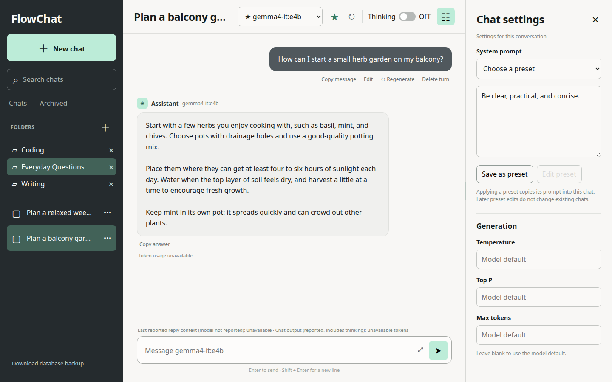
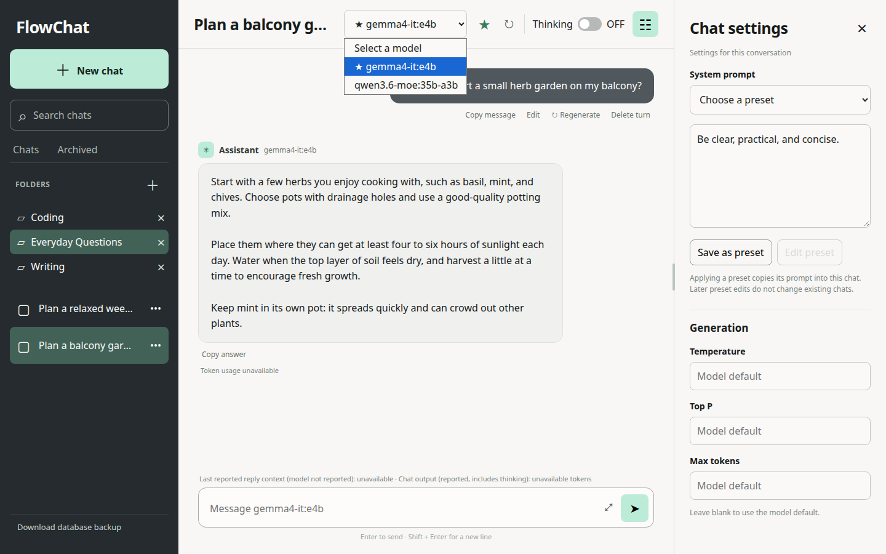
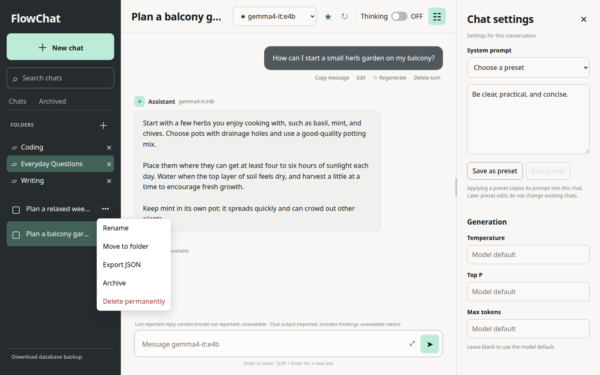

# FlowChat for FastFlowLM

I created FlowChat because I couldn't find a web interface or desktop client that did what I wanted. It provides a local chat interface for an OpenAI-compatible FastFlowLM server.

Chat history, settings, and prompt presets are stored in a SQLite database on the machine running the app. Your browser communicates with the app through its `/api` routes, and the app communicates with the configured model server.

I tested it on a Framework Desktop using FastFlowLM with the neural processing unit (NPU).

## Other compatible servers

FlowChat is designed and tested with FastFlowLM. Developers and testers may also be able to use it with other servers that provide an OpenAI-compatible API, but those servers have not been tested as part of this project. Set `FASTFLOWLM_BASE_URL` to the server's address, even if the server is not FastFlowLM.

The server must provide a model list and support streaming chat completions. Compatibility also depends on whether it accepts the settings FlowChat sends, including the `think` parameter. FlowChat does not currently provide a way to configure an API key, so it cannot directly connect to endpoints that require one. If you connect to a remote server, your conversations are sent to that server.

## Features

- Choose from the models available on your model server and save favorites in your browser.
- Watch replies as they are generated and stop a reply when you need to. If a response is interrupted, its partial text is saved.
- Edit a message or regenerate a reply, with the option to keep the original conversation as a separate branch.
- Organize conversations in folders, search their titles, and archive or restore them.
- Save reusable system prompts and adjust settings such as temperature and response length for each conversation.
- Export individual conversations as JSON or download a backup of the database.
- Keep your chat history, settings, and prompt presets in a SQLite database on the machine running the app.

## Screenshots

These screenshots use sample conversations and a simulated model list. The example replies were written for illustration, not generated by the models.

### Conversations and settings



### Model selection



### Folder management



## Run with Docker Compose

Install Docker with Compose, then copy the example configuration:

```sh
cp .env.example .env
```

Edit `.env` and enter the address and port of your FastFlowLM server. The sample service name works when the containers share a Docker network. Then run:

```sh
docker compose up --build -d
```

Open <http://127.0.0.1:8080>. The `chat-data` volume keeps your SQLite database at `/data/chat.sqlite3` inside the container when the container is restarted or rebuilt. `docker compose down` stops the app without deleting that volume. `docker compose down -v` also permanently deletes its data.

By default, Compose connects to `http://fastflowlm:8000`, an example service name and container port on a shared Docker network. Change the address and port to match your setup. For example:

```sh
FASTFLOWLM_BASE_URL=http://your-fastflowlm-service:9000 FRONTEND_PORT=8081 docker compose up --build -d
```

If FastFlowLM is another container, both services must join a shared Docker network. Set `FASTFLOWLM_BASE_URL` to its **Compose service name and its internal listening port**, for example `http://fastflowlm:8000`; the host-published port may be different. When integrating `chat-app` into an existing Compose file, copy the service definition, point `build` at this repository directory, and attach it to the same network as the FastFlowLM service. Use the service name and internal port for your FastFlowLM container. The URL may include `/v1`; the app adds it when omitted.

By default, the app is reachable only from the machine running it. To make the app reachable on your network, set `CHAT_BIND_ADDRESS` to the desktop’s LAN IP (for example `192.0.2.10`), or use `0.0.0.0` for all interfaces, and configure `FRONTEND_PORT`. The app has no login, so anyone who can reach it can read and modify its chats and use the connected model. Restrict network access accordingly.

## Local development

Use Python 3.12 or newer and Node.js 22 or newer:

```sh
python -m venv .venv
. .venv/bin/activate
pip install -r requirements.txt
npm ci
FASTFLOWLM_BASE_URL=http://192.0.2.10:8000 uvicorn app.main:app --host 127.0.0.1 --port 8080
```

Replace `192.0.2.10:8000` with your FastFlowLM host and listening port; use `127.0.0.1:8000` when it runs on the same host. In a second terminal run `npm run dev` and open the Vite URL. Vite proxies `/api` to `http://127.0.0.1:8080` by default; set `VITE_API_PROXY_TARGET` when the app server is elsewhere. Configure the FastFlowLM URL on the Python server, not in the browser. Without `FASTFLOWLM_BASE_URL`, the Python server defaults to `http://127.0.0.1:8000`. The database is stored at `./data/chat.sqlite3` by default. Set `CHAT_DATA_DIR` to use a different directory.

Run `npm run build` to check the types and build the interface in `dist/`. The Python server serves that directory when it exists. Run only one Uvicorn worker so that the app can stop responses correctly.

## Uninstall and remove data

To stop and remove the Docker Compose container, network, and database volume, run this from the project directory:

```sh
docker compose down -v --rmi all
```

This permanently deletes the `chat-data` volume, including all chats, settings, and prompt presets stored in the database. It also removes the app image, including if another container uses the same image tag. Model favorites are saved separately in your browser; clear the site data for the app's address to remove them.

For a local development installation, stop the app and delete the `data` directory to remove its database. If you set `CHAT_DATA_DIR`, delete that directory instead. You can also delete `.venv`, `node_modules`, and `dist`, then remove the project directory when you no longer need it. Deleting the project directory also removes any `.env` configuration file it contains.
